# Manual de utilizador

[Índice](../README.md) · [← Apresentação final](../07-scrum/apresentacao-sprint-5.md)

Guia curto do sistema de gestão de pedidos de funcionalidades e roadmap, organizado por papel. A palavra-passe de cada conta de teste é o nome seguido de `123` (por exemplo, `sofia123`) (ver [Como correr o projeto](../06-codigo/como-correr.md)).

## Primeiros passos (todos os papéis)

### 00 · Boas-vindas

Quem chega ao endereço principal sem sessão iniciada vê o resumo do fluxo (**Novo**, **Em análise**, **Em desenvolvimento** e **Concluído**) e os atalhos para entrar ou criar conta. Quem se regista começa como cliente; o administrador atribui depois o papel na equipa.

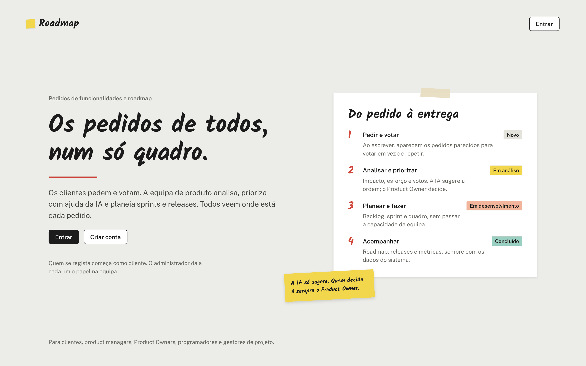

### 01 · Entrar

**Usado por:** todos os papéis (`sofia`, `marta`, `ricardo`, `diogo`, `helena`).

Permite iniciar sessão com utilizador e palavra-passe ou alternar para o registo de nova conta.

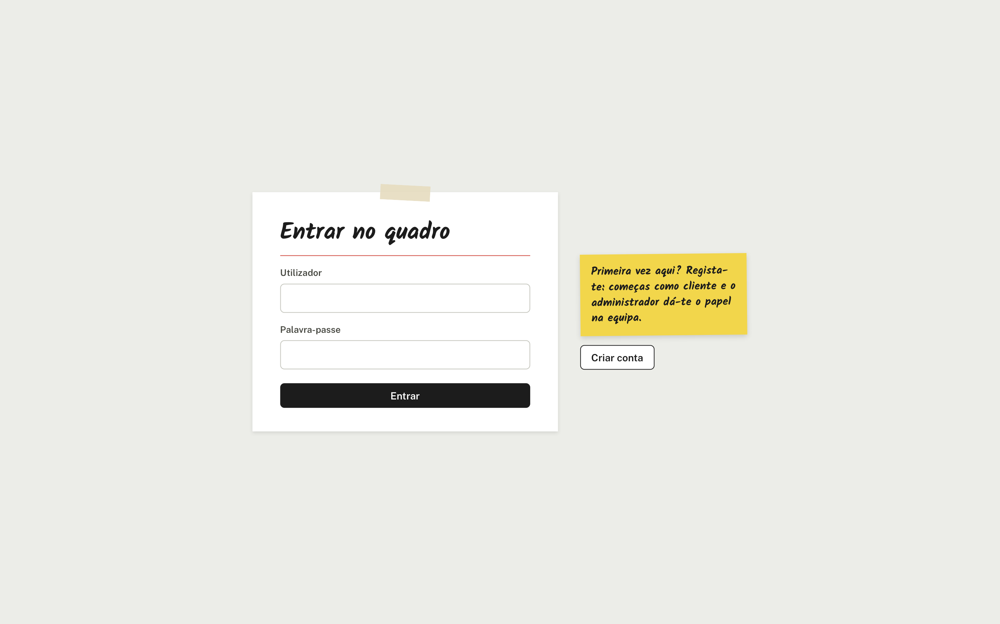

---

## Cliente (`sofia`)

O cliente submete pedidos, vota nos que considera mais úteis, comenta e acompanha o estado de cada pedido.

### 02 · Pedidos

**Usado por:** cliente (`sofia`) e restantes papéis.

Mostra todos os pedidos com pesquisa por título ou descrição, filtros por estado, categoria, etiqueta e «Só os meus pedidos», ordenação e exportação em CSV.

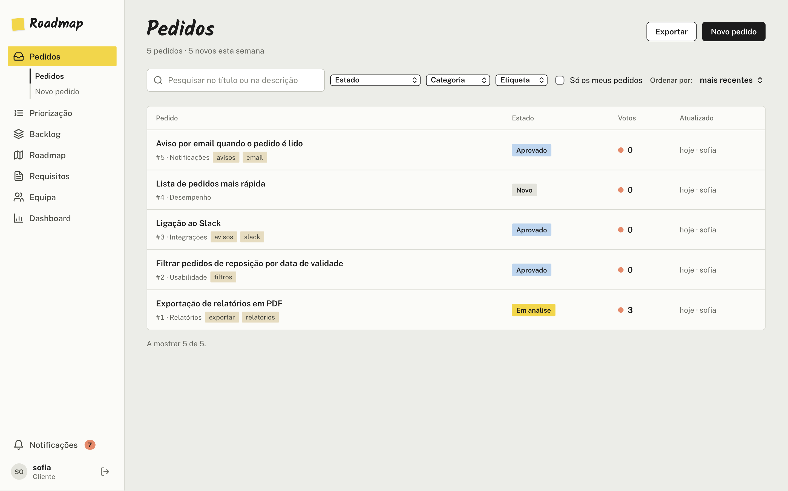

### 03 · Novo pedido

**Usado por:** cliente (`sofia`) e equipa.

Permite submeter um pedido com título, descrição, categoria e etiquetas separadas por vírgulas. Enquanto se escreve, o sistema mostra pedidos parecidos para evitar duplicados e permitir votar num existente. A equipa pode também indicar a origem quando regista em nome de alguém.

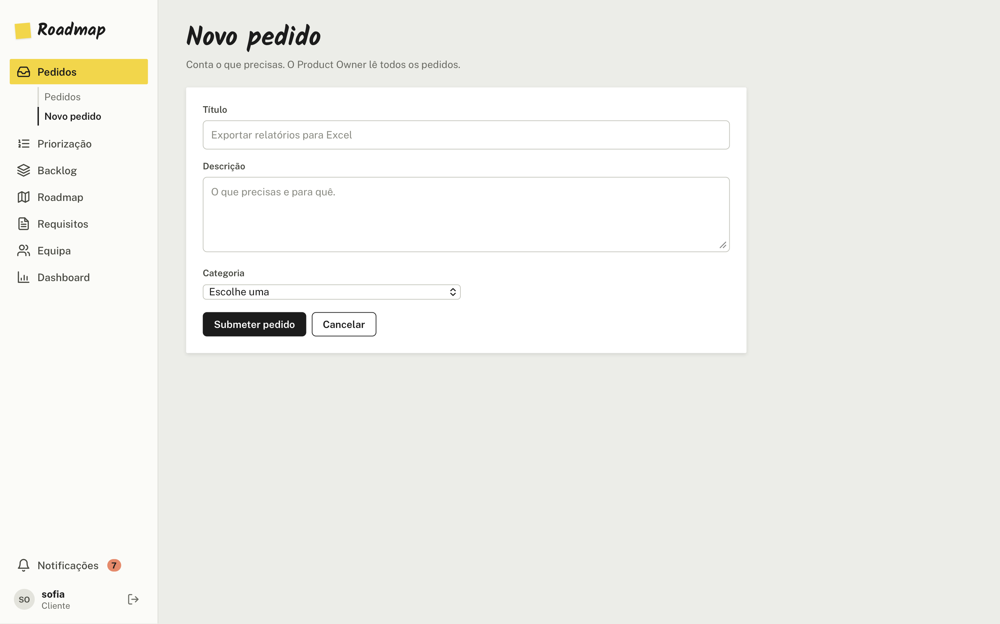

### 12 · Notificações

**Usado por:** cliente (`sofia`) e restantes papéis.

Lista os avisos por ler e lidos (menções com `@`, mudanças de estado e novos comentários em pedidos seguidos) e permite configurar as preferências de notificação no painel lateral, incluindo aviso por email.

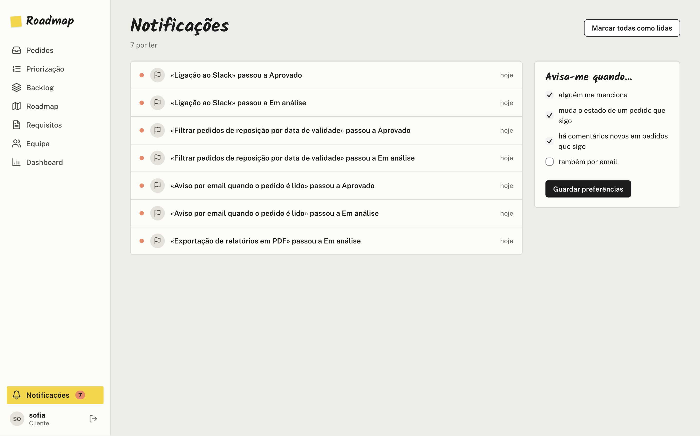

---

## Product manager (`marta`)

O product manager analisa pedidos, gere etiquetas e versões, planeia o roadmap e acompanha releases, dependências e milestones.

### 04 · Detalhe do pedido

**Usado por:** product manager (`marta`), Product Owner (`ricardo`) e restantes papéis (com ações consoante o papel).

Reúne a descrição, etiquetas, votos, conversa com menções (`@`) e histórico de estados. Quem tem permissão pode **Editar** título e descrição (cada edição fica em **Versões**, onde se comparam duas lado a lado ou se repõe uma anterior), mudar o estado (com motivo obrigatório ao rejeitar) e atualizar etiquetas.

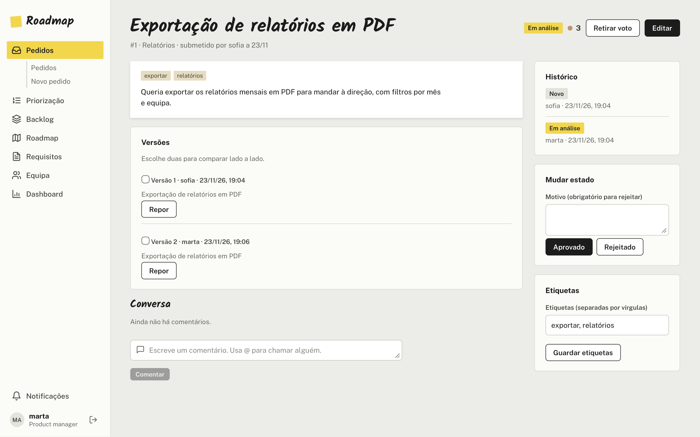

### 08 · Roadmap

**Usado por:** product manager (`marta`) para criar releases; visível a toda a equipa.

Mostra a linha temporal das releases com o progresso, o indicador da data de hoje e o aviso **Em risco** quando faltam duas semanas ou menos para a data prevista e ainda há pedidos por concluir. Clicar numa release abre o seu detalhe.

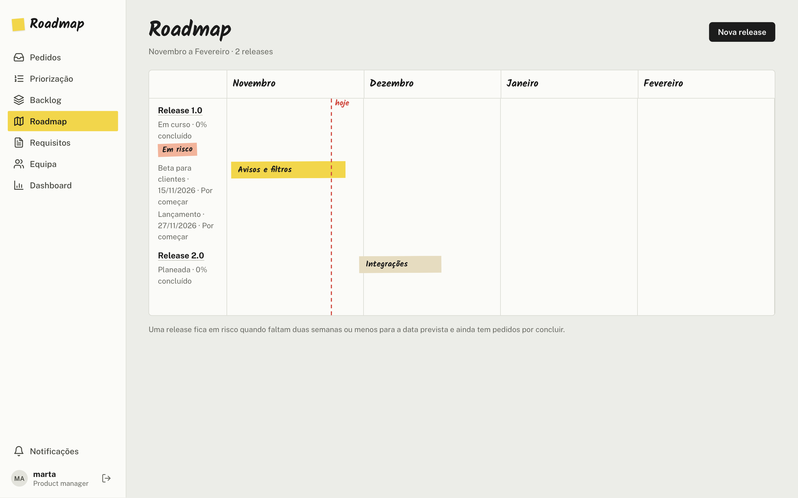

### 09 · Release

**Usado por:** product manager (`marta`) para gerir funcionalidades, milestones e lançar a release; programador (`diogo`) pode também registar dependências.

Mostra as funcionalidades da release, permite adicionar ou tirar pedidos aprovados, criar e apagar **Dependências** entre pedidos (com um aviso quando um pedido depende de outro que não está concluído nem numa release anterior) e gerir **Milestones** com data e estado calculado automaticamente.

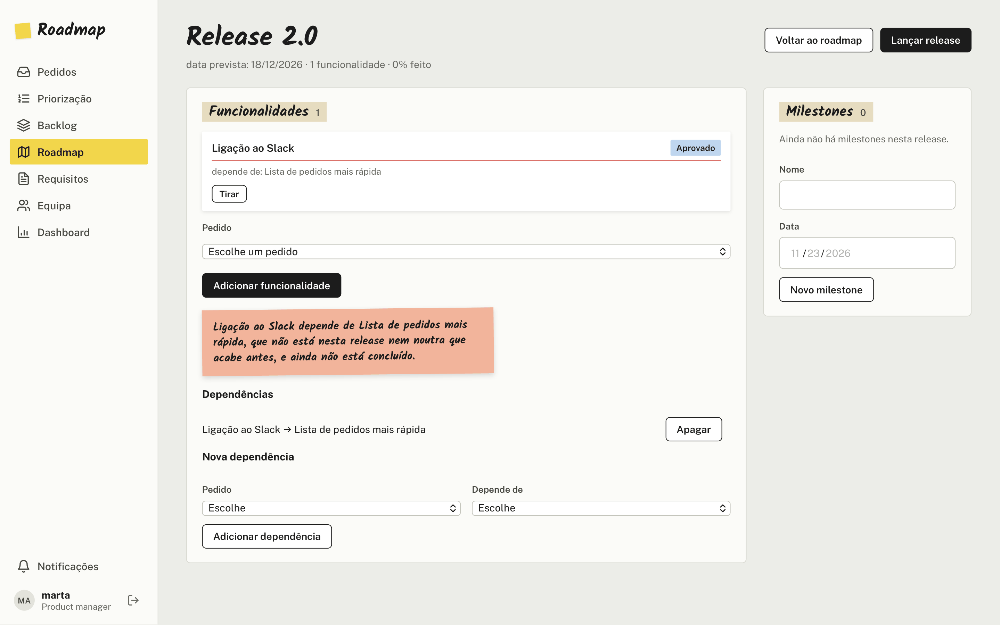

---

## Product Owner (`ricardo`)

O Product Owner define a ordem de prioridade, planeia e arranca sprints, acompanha o quadro e valida user stories.

### 05 · Priorização

**Usado por:** Product Owner (`ricardo`) para ordenar, estimar impacto/esforço e guardar a razão; visível aos restantes papéis.

Lista os pedidos aprovados e em análise com votos, impacto e esforço em pontos. O Product Owner ajusta os valores, reordena com as setas (`↑`/`↓`), consulta o histórico de decisões e pode pedir uma sugestão à IA, que só muda a ordem se a aceitar.

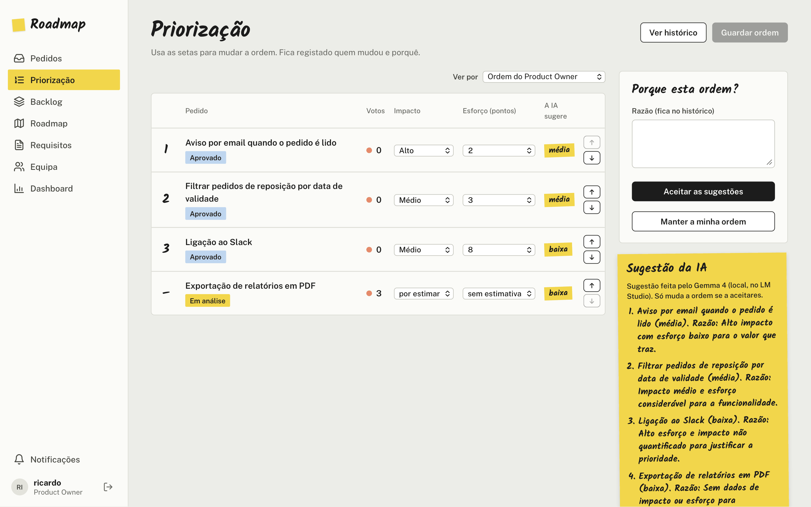

### 06 · Planear sprint

**Usado por:** Product Owner (`ricardo`) para compor e iniciar o sprint; visível à equipa.

Apresenta o **Product backlog** à esquerda e o sprint em planeamento à direita, com os botões «Pôr no sprint» e «Tirar do sprint», barra de capacidade em pontos e o botão **Começar sprint**.

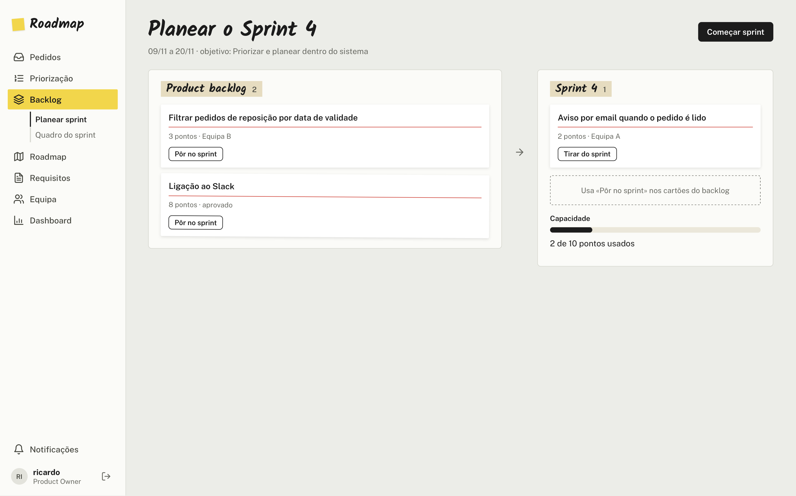

### 07 · Quadro do sprint

**Usado por:** Product Owner (`ricardo`) e programador (`diogo`) durante o sprint em curso.

Organiza os cartões do sprint ativo em quatro colunas: **Aprovado**, **Em desenvolvimento**, **Em revisão** e **Concluído**, com filtro por equipa, botões para avançar cada cartão de coluna e opção para fechar o sprint.

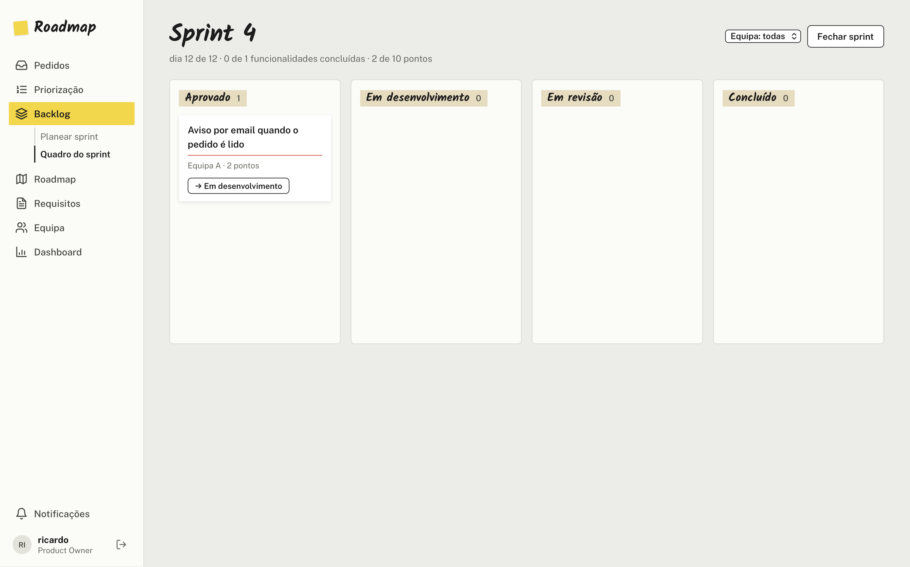

### 10 · Gerar user stories

**Usado por:** Product Owner (`ricardo`) para gerar, editar, aceitar ou rejeitar propostas; visível aos restantes papéis.

A partir de um pedido aprovado, gera propostas de user stories e critérios de aceitação (pela IA, o Gemma 4 no LM Studio, ou por um modelo simples a partir do pedido quando a IA não está ligada). Só ficam guardadas as propostas que o Product Owner aceitar, com as edições que fizer.

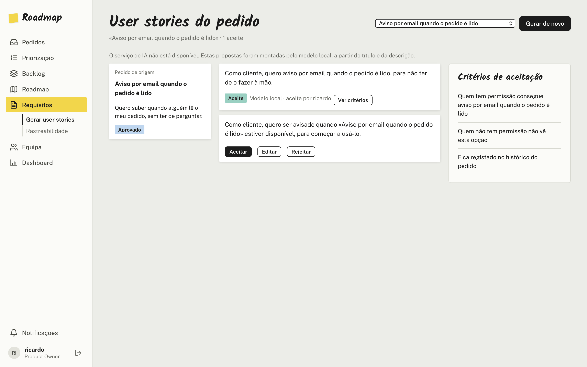

---

## Programador (`diogo`)

O programador implementa funcionalidades do sprint, liga commits às user stories e coordena o trabalho no espaço da equipa.

### 11 · Rastreabilidade

**Usado por:** programador (`diogo`) para ligar commits; Product Owner (`ricardo`) para marcar critérios cumpridos; visível a todos para auditoria.

Mostra a cadeia completa **Pedido → User stories → Implementação** para cada pedido aprovado, com pesquisa por pedido, user story ou commit e filtro «Só o que falta ligar». Na coluna de implementação, o programador associa o endereço do commit e uma breve descrição do que foi feito.

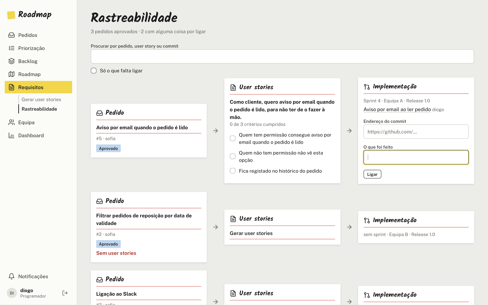

### 13 · Espaço da equipa

**Usado por:** programador (`diogo`), membros da equipa e gestor de projeto (`helena`).

Permite escolher a equipa e ver os seus membros (**Quem somos**), os pedidos atribuídos (**O nosso trabalho**) e a **Conversa da equipa**, onde os membros e o gestor de projeto podem publicar mensagens.

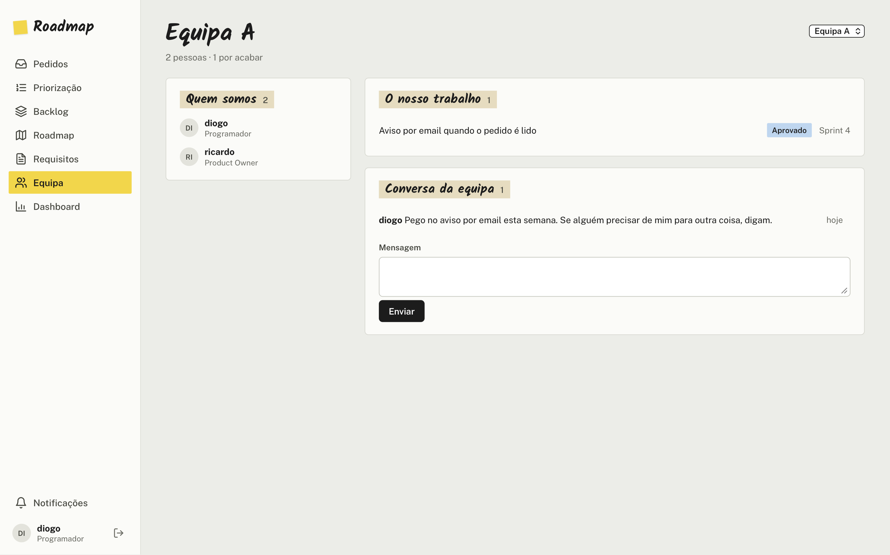

---

## Gestor de projeto (`helena`)

O gestor de projeto acompanha métricas de entrega, atrasos, compromissos contratuais e a carga de trabalho de cada equipa.

### 14 · Dashboard

**Usado por:** gestor de projeto (`helena`) para marcar compromissos e exportar progresso; visível aos restantes papéis.

Calcula automaticamente os indicadores do período selecionado (submetidos, aprovados, rejeitados, *lead time* e *cycle time*), gráficos de funcionalidades por release e pedidos por mês, lista de pedidos parados há mais de três dias e o **Progresso do roadmap**. O gestor de projeto pode marcar funcionalidades como **Compromisso** (aparecem primeiro) e exportar o relatório em CSV.

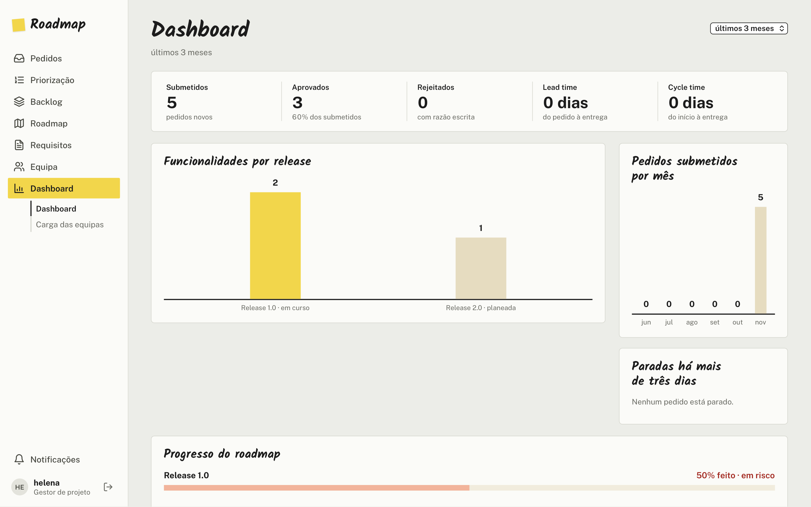

### 15 · Carga das equipas

**Usado por:** gestor de projeto (`helena`) para ajustar capacidade, atribuir equipas e classificar o tipo de trabalho; visível aos restantes papéis.

Mostra a carga de cada equipa no sprint em pontos, dividida por tipo de trabalho (**Novo**, **Manutenção**, **Bugs**, **Administrativo**), face à linha de capacidade, com um aviso quando uma equipa a passa. Permite ao gestor de projeto alterar a capacidade por equipa e atribuir equipa e tipo a cada item do sprint.

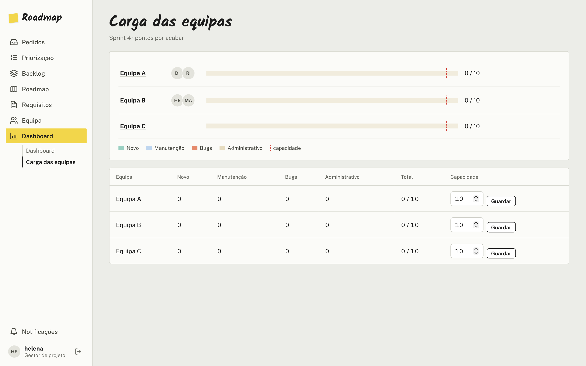

## Ver também

- [Como correr o projeto](../06-codigo/como-correr.md)
- [IA no sistema](../04-arquitetura/ia.md)
